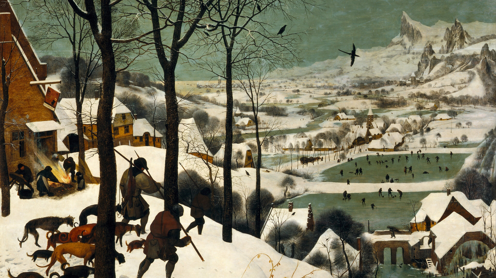

# Bruegel

A dark Omarchy theme drawn from the paintings of Pieter Bruegel the Elder.
The palette was sampled from the backgrounds below. All images are public-domain scans from Wikimedia Commons:

1. Hunters in the Snow (1565), Kunsthistorisches Museum, Vienna
2. The Harvesters (1565), Metropolitan Museum of Art, New York
3. The Tower of Babel (1563), Kunsthistorisches Museum, Vienna
4. The Return of the Herd (1565), Kunsthistorisches Museum, Vienna
5. The Gloomy Day (1565), Kunsthistorisches Museum, Vienna
6. Netherlandish Proverbs (1559), Gemäldegalerie, Berlin
7. The Triumph of Death (c. 1562), Museo del Prado, Madrid

## Install

```bash
omarchy theme install https://github.com/felipelube/omarchy-bruegel-theme.git
```

The theme uses the Gruvbox Plus icon theme. Install it from the AUR so the icons apply:

```bash
omarchy pkg aur add gruvbox-plus-icon-theme
```


